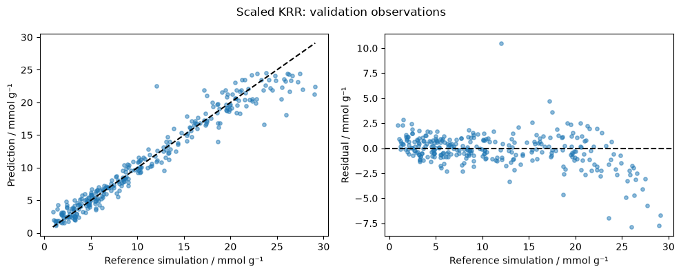
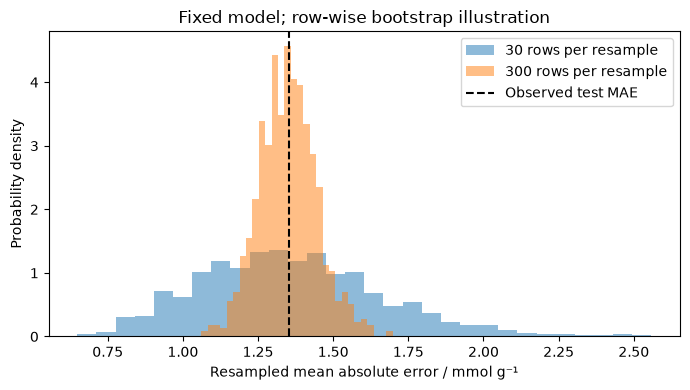

With the calibration curve, one number described the input: concentration. A porous material gives us many more possibilities. We could supply the identities and positions of its atoms, or replace most of that detail with a few measurements of its pores. The choice is already part of the model, before we fit a single parameter. What would we like the prediction to help us do, and which description might be enough for that purpose?

For the [11 November lecture](../sessions/2026-11-11.qmd), follow the target and descriptors, training/validation/test splitting, the baseline, cross-validation, the visual kernel example, and standardisation. The [annotation slides](../downloads/11-november-ml-molsim.pdf) provide the concise route. Kernel derivations, feature-importance analysis, and bootstrap uncertainty are reference material for later lectures. The main supported hands-on session is **2 December**.

## What should you be able to do afterwards? {#lecture-outcomes}

After working through the uptake practical, you should be able to:

- State exactly which uptake the model predicts, including its conditions and the fact that the reference values come from simulations. Explain one omission in the supplied descriptors.
- Compare a model with a constant prediction and explain why changing the scale of the inputs can change a model's idea of similarity.
- Choose a model using validation data, then report its test error with the metric, units, sample size, and scope of the comparison.
- Use resampling to examine variation in an error estimate, and explain why repeating the recorded errors adds no evidence about a new family of materials or a different experiment.
- Propose an alternative explanation for a good prediction and a comparison that could help distinguish it from the chemical explanation we had in mind.

## A porous material and a prediction

Suppose we have a collection of porous materials and would like to decide which deserve a more expensive calculation. A metal–organic framework, or **MOF**, connects metal-containing nodes with organic linkers. Different choices of nodes and linkers give different pore geometries and chemical environments. How much carbon dioxide might a particular framework take up?

We can ask a more manageable version of that question. Our table contains uptake values computed by molecular simulation, along with descriptions of the structures. We will try to predict the computed uptake of another entry in that collection. The target concerns pure CO₂ at 298 K and 1.6 MPa, or 16 bar, in mmol per gram of framework. These conditions are part of the target, even though they do not vary between rows. The exercise adapts the [MolSim practical](https://github.com/kjappelbaum/ml_molsim/tree/0ebed176b972c9ba9ddf7b6e3a4d04eaf3f32409).

It is tempting to shorten the question to “find a good material for carbon capture.” But that would add questions about mixtures, water, stability, regeneration, synthesis, and the process in which the material will be used. A prediction at one set of conditions can help with that work. It does not specify the whole decision.

### Where does the learned model enter? {#where-ml-enters}

“Use machine learning to calculate uptake” still leaves an important question open: which part of the calculation should be learned? The diagram in my [MolSim lecture, p. 3](https://www.compchem.nl/wp-content/uploads/molsim2023/L09_Machine-Learning.pdf#page=3), puts several possibilities beside one another.

One route to uptake begins with a model of the interactions between atoms and molecules. A simulation then samples configurations and uses them to estimate the amount adsorbed under the specified conditions. We could learn an approximation to the interaction energies and use it within that simulation. Alternatively, we could collect the uptake values from completed simulations and learn to predict those values directly. This second route is what our practical does. Its predictor is a **surrogate** for a specified simulation result.

There is a further possibility: keep the energy model and learn a way to propose configurations that would otherwise be difficult to sample. These three uses of learning change different parts of the calculation. Agreement with uptake values, for example, does not establish that the model can calculate forces or generate a physically meaningful trajectory.

### A published example {#published-example}

.](../assets/mof-paper-header.jpg){fig-alt="Article title, authors and journal details for Moosavi et al. (2020), Understanding the diversity of the metal-organic framework ecosystem." width=794}

The [paper](https://www.nature.com/articles/s41467-020-17755-8#Sec5) uses **kernel ridge regression with an RBF kernel** to predict simulated MOF adsorption properties. Its workflow includes structural descriptors, standardisation, cross-validation and held-out assessment. These are the same kinds of modelling ingredients we will use in the practical.

Our notebook makes the problem small enough to explore in class: 1,500 rows, eight geometric descriptors, one CO₂ uptake target at 298 K and 16 bar, and a few candidate models. The paper considers additional chemical RAC descriptors, multiple adsorption tasks and databases, and more extensive feature selection, tuning and evaluation. We are learning the method through a compact example; reproducing the paper's numerical results would require its full protocol.

## What do we keep from a structure?

Imagine replacing a framework drawing with two numbers: its density and its pore volume per gram. We have retained information that might be useful for gas uptake, while discarding the identities and arrangement of many atoms. These numbers are [descriptors](../glossary.qmd#descriptor). In the practical, eight geometric descriptors become the model's [features](../glossary.qmd#feature).

| Information we supply | Example | What remains open |
|---|---|---|
| Pore dimensions | A diameter describing a sphere that can pass through the pore network | Which chemical groups line that pore? |
| Surface area and pore volume | Surface area per gram; pore volume per gram | How strongly does CO₂ interact with the surface? |
| Density | Framework mass per volume | Are two frameworks with similar density chemically similar? |

The [data notes](../data/mof-uptake/README.md) give the exact column names, units, and source. Remember that we are approximating a simulation result. Agreement with experimental uptake would be a further comparison.

**Discuss:** Which two frameworks might look similar through these descriptors while differing in a way that matters for adsorption?

### Adding chemistry with RACs {#rac-features}

The original MolSim notebook also uses **revised autocorrelation functions (RACs)**. These combine products or differences of atomic properties over pairs separated by a chosen number of bonds, with selected starting atoms and environments such as metal centres or linkers. Properties include electronegativity, nuclear charge, connectivity, covalent radius, and identity. This adds information about local chemistry to the geometric description. See the [RAC documentation](https://mofdscribe.readthedocs.io/en/latest/featurizers/atom_centered/racs.html).

Our compact class notebook retains **only eight geometric features**. We mention RACs to identify what that simplification leaves out; calculating them is outside this practical.

## A prediction without descriptors {#first-ask-whether-the-inputs-help}

Before fitting a relationship, predict the same uptake for every material. Our **baseline** uses the median training uptake. It ignores the descriptors entirely. If a more elaborate model cannot improve on that reference, the extra machinery has not yet earned its place.

We compare models using mean absolute error:

$$
\operatorname{MAE}=\frac{1}{n}\sum_{i=1}^n |\hat y_i-y_i|.
$$

For residuals $-2,0,+1$ mmol/g, the MAE is $1$ mmol/g. The median minimises the sum of absolute deviations for a constant prediction. Choosing squared error would instead lead us to the mean. We have already made a modelling choice before selecting a learning algorithm.

## Why fitting can go wrong

A model can reduce training error by following details specific to those observations. This is **overfitting** when those details do not generalise. Imagine repeatedly drawing a training sample and fitting the same procedure. **Bias** is the systematic difference between the average prediction and the underlying mean relationship; **variance** describes how much predictions change across these refits. A simple model can consistently miss a relationship, while a flexible one can be sensitive to which observations it sees.

Regularisation constrains the fit. For ridge regression, one common convention writes the objective as

$$
\sum_{i=1}^{n_{\mathrm{train}}}(y_i-\widehat y_i)^2 + \alpha\sum_{j=1}^{p}w_j^2.
$$

The first term rewards agreement with training targets; the second penalises large coefficients, leaving the intercept unpenalised. Increasing $\alpha$ can reduce sensitivity to the sample at the cost of more systematic mismatch. We use validation data to choose the strength rather than assuming the strongest penalty is best.

## From a straight line to similarities {#kernels-as-functions}

Our calibration line adds two functions, a constant and a multiple of concentration. A polynomial adds further powers. We choose these building blocks first and then fit their coefficients. A kernel model offers another construction: place a function at each training input and fit the coefficients of their sum. This is the comparison in the [MolSim lecture, pp. 53–57](https://www.compchem.nl/wp-content/uploads/molsim2023/L09_Machine-Learning.pdf#page=53).

For the first lecture, the key idea is to fit a sum of local contributions. A Gaussian kernel supplies bell-shaped functions centred on the training inputs; its width changes which inputs look similar. The fitted coefficients can be negative, so the prediction is not simply an average of nearby values. We use **[kernel ridge regression](../glossary.qmd#kernel-ridge)**, which also uses a penalty to constrain the fit. First work through a small kernel-trick calculation, then connect it to the Gaussian model used in the practical.

### The kernel trick, calculated by hand

Use the feature map

$$
\phi(x)=(x_1^2,\sqrt{2}\,x_1x_2,x_2^2).
$$

For $x=(1,2)$ and $z=(3,4)$, this gives $\phi(x)=(1,2\sqrt{2},4)$ and $\phi(z)=(9,12\sqrt{2},16)$. Their inner product is

$$
\phi(x)^\mathsf{T}\phi(z)=9+48+64=121.
$$

We obtain the same number directly from the original inputs:

$$
k(x,z)=(x^\mathsf{T}z)^2=(1\cdot3+2\cdot4)^2=11^2=121.
$$

Expanding the square shows why this works for any two input vectors in this example. The **kernel trick** evaluates a feature-space inner product without constructing all the feature coordinates. This tiny example demonstrates the equality; the advantage becomes clearer for much larger feature spaces. Our notebook uses a different kernel, the Gaussian kernel, which also corresponds to a feature-space inner product, with infinitely many feature coordinates.

### Adding three functions

The small demonstration below uses three invented observations and one dimensionless input. The coloured curves show the three weighted contributions; the dark curve is their sum. Moving the query changes where we evaluate the same fitted function. Changing $\gamma$ or $\alpha$ fits a new function to the same observations.

```{=html}
<iframe class="activity" src="../activities/kernel.html" title="Three Gaussian kernel functions and their fitted sum"></iframe>
```

[Open the kernel demonstration](../activities/kernel.html). First move the query and add the three displayed contributions. Then predict what will happen when the bells become narrower, before changing $\gamma$. Can you find a region where the curves disagree although there is no observation to decide between them? These three training observations cannot establish which setting predicts future measurements better.

In the MOF practical, each input has eight coordinates rather than one. The construction is the same, but now the distance depends on every descriptor and its scale.

<details>
<summary>Optional: the kernel ridge equations</summary>

We use **[kernel ridge regression](../glossary.qmd#kernel-ridge)**. Our Gaussian kernel gives a similarity to two scaled feature vectors $x$ and $z$:

$$
k(x,z)=\exp\left(-\gamma\lVert x-z\rVert^2\right).
$$

The squared distance $\lVert x-z\rVert^2$ adds the squared differences between corresponding entries. The setting $\gamma$ controls how quickly similarity falls with distance. For a single input coordinate, each training example becomes the centre of a bell-shaped function. A larger $\gamma$ makes that bell narrower. The prediction is

$$
\hat y(x)=\sum_{i=1}^{n_{\mathrm{train}}} a_i\,k(x,x_i).
$$

Here $x_i$ is a training input and $a_i$ is its fitted coefficient. The coefficients can be negative, and the sum is not a normalised average of nearby uptake values. The regularisation setting $\alpha$ controls the penalty used during fitting. We will compare an unscaled and a scaled version with the same settings. A scaled linear ridge model provides another useful comparison. [scikit-learn's KRR introduction](https://scikit-learn.org/stable/modules/kernel_ridge.html)

</details>

## Why would changing units change a prediction?

One model in the practical compares materials through distances between their feature vectors. Suppose two rows differ by 0.1 g/cm³ in density and by 100 m²/g in specific surface area. If we take the numerical values as coordinates, their squared differences contribute 0.01 and 10,000. Expressing the same surface area in m²/kg multiplies that coordinate difference by 1,000. The materials have not changed, but their numerical distance has. Before using distance as a measure of similarity, we need to decide what a step along each coordinate should mean.

**Standard scaling** subtracts each feature's training mean and divides by its training standard deviation. The resulting coordinates are dimensionless. This makes the distance insensitive to a consistent change of units, but it still gives each feature a particular weight: one training standard deviation. That is a modelling convention, not evidence that the features are equally informative. The transformation is itself fitted, so we estimate those means and standard deviations from training data and apply the same transformation to validation and test data. A [pipeline](../glossary.qmd#preprocessing) keeps the transformation and model together.

## Choosing a model with validation data {#which-observations-may-influence-the-choice}

Fitting uses the training answers to reduce their error. Assessing the model on those same answers can therefore be optimistic: memorising them could look perfect while failing on new cases. Held-out data lets us assess predictions on answers unused in fitting. Validation answers guide model selection, so we reserve a separate test set for assessment after selection.

Our compact table contains 1,500 rows selected from the workshop data without selecting on uptake. The notebook assigns 900 rows to training, 300 to validation, and 300 to the final test. We inspect training observations, fit the candidate models, and compare their validation errors. We then freeze the choice and calculate its test error. Picking the lowest validation error also uses those answers: some candidates can look unusually good on that particular finite sample. The winning validation score can therefore be optimistic. The separate test evaluates the selected model without having participated in that choice.

A different identifier does not necessarily mean a chemically independent framework. Two MOFs may share building blocks. This random row split supports a limited question about other entries in this collection; testing a new framework family would require a suitable definition of families and a split that respects it.

The [model-selection practical](model-selection.qmd#why-cross-validation) extends this single-split comparison to cross-validation: repeated fitting with different development observations held aside. We will ask why this can help with limited data, what must be refitted inside each fold, and why the selected setting still needs an assessment after selection. The current MOF notebook deliberately retains its transparent training/validation/test split; the cross-validation exercise uses a separate simulated dataset.

The data-leakage case study in [Jablonka et al. (2023), *An Ecosystem for Digital Reticular Chemistry*](https://doi.org/10.1021/acscentsci.2c01177), examines why data preparation and evaluation belong together. It gives us a research example against which to question our own split.

The plot below shows the chosen model's **validation** predictions in the supplied run. In the left panel, the diagonal marks agreement with the reference simulations. The right panel makes the residuals visible. These observations helped us choose the model, so they cannot also supply its untouched final assessment.



### Which materials does an average describe? {#average-for-which-materials}

Suppose our purpose is to find unusually high-uptake materials. A random validation sample can contain many ordinary materials and very few exceptional ones. A low average error over the whole sample may then tell us little about the region we hope to search. The [MolSim lecture, p. 25](https://www.compchem.nl/wp-content/uploads/molsim2023/L09_Machine-Learning.pdf#page=25), raises this problem for material screening.

In our validation plot, inspect the high-uptake region separately. How many points support a claim there, and do the errors look similar to those elsewhere? An observation here can suggest a further evaluation, but it does not turn this region into an untouched test set. If selecting the best candidates is the intended use, we should plan an assessment of that selection before making a discovery claim. Predicting uptake accurately on average and selecting useful candidates are related tasks with different evidence requirements.

### What else could explain a good prediction? {#clever-materials}

Research groups often specialise in particular materials, methods, and problems. Those choices can leave patterns in a collection of published results. Could a predictor use such patterns to answer our property question?

In my preprint [*Clever Materials: When Models Identify Good Materials for the Wrong Reasons*](https://arxiv.org/abs/2602.17730v1) (2026), I compare a direct property predictor with a second route:

| Route | Calculation |
|---|---|
| Direct | Chemical descriptors → predicted property |
| Through publication information | Chemical descriptors → predicted authors, journal, and year → predicted property |

Here, **metadata** means information about the publication. In the second route, the property model receives predictions of that information. The comparison uses the same held-out folds. Its performance is sometimes close to the direct predictor's, depending on the task and metric. This leaves a competing explanation to investigate; it does not establish which route the direct predictor actually uses. The paper examines different datasets from our computed-uptake practical.

**Discuss:** What information would we need to test performance on materials reported by another group or after a particular date? Would simply deleting author names from the input table remove information about authorship from the chemical descriptors?

#### What does 90% accuracy tell us?

For membership in the top 10% of thermally stable MOFs, Section 2.1 reports accuracy of 0.901 for the predicted-metadata route and 0.923 for the direct route. Before interpreting these numbers, work through a simpler calculation.

Suppose exactly ten of a hundred materials belong to the desired class. A rule that calls every material “not in the top ten” is correct ninety times. It has **90% accuracy and finds none of the ten materials we wanted**. These hundred cases are a constructed example, not a reconstruction of the paper's predictions.

If our aim is to find exceptional materials, we should also ask how many of them we recover and how many of our selections are actually exceptional. These questions define [**recall** and **precision**](../glossary.qmd#classification-metrics) for the desired class. Accuracy alone does not answer them. The paper's classification dummy draws labels according to training-class frequencies; it is a different comparison from always predicting the majority class. Its appendix compares other metrics. Their averaging conventions matter too.

What would make the comparison more informative? Choose a baseline, a metric, and a split for a stated use. Explain which alternative each choice tests. A split by publication date examines a different use from a random split; it does not, by itself, establish a chemical mechanism. Likewise, close accuracy values do not settle whether the two predictors find the same useful materials.

## The uncertainty in a test error {#a-test-score-still-has-a-hat}

There are two different quantities here. For a fixed fitted model $\widehat f$, we want the average error on future cases from the intended population $P$:

$$
R(\widehat f)=\mathbb{E}_{(X,Y)\sim P}\left[\left|\widehat f(X)-Y\right|\right].
$$

We cannot average over every future MOF. Instead, we calculate an average over our finite reserved sample:

$$
\widehat R_{\mathrm{test}}(\widehat f)=\frac{1}{n_{\mathrm{test}}}\sum_{i\in\mathrm{test}}\left|\widehat f(x_i)-y_i\right|.
$$

The model stays fixed during this assessment; changing the model after seeing the test results changes the status of those observations.

The chosen model gives one error for each of the 300 reserved test rows. Averaging them gives an empirical test MAE. The calculation is exact for those rows, up to numerical precision, while the expected error on future cases remains uncertain. Another finite test sample can give a different average. For example, invented absolute errors $(1,1,4)$ have mean $2$, while $(1,2,0)$ have mean $1$. These toy samples illustrate sampling variation, not two runs of the MOF notebook. More representative, independent rows can improve precision; more rows from the wrong population do not establish performance on the intended materials.

Keep the fitted model fixed and draw samples, with replacement, from the recorded test errors. This [bootstrap](../glossary.qmd#bootstrap) creates a distribution of average errors under a particular sampling assumption. The notebook compares averages of 30 sampled rows with averages of 300. The larger averages fluctuate less in this illustration.



We have repeatedly drawn from the same recorded errors. There are still no new frameworks, simulations, or experiments. The calculation treats rows as independent sampling units, an assumption that related frameworks can make inadequate. Nor can repeating these rows tell us how the model will perform under another simulation protocol. We have met this problem with the calibration instrument already: [sampling uncertainty and a change in distribution](02-learning-from-data.qmd#empirical-error-and-population-risk) ask different things of our evidence.

## Practical

Choose a model using the training and validation data, record the choice, then inspect its test error. I would like you to be able to explain why you chose that model and which future predictions you think the test result tells us something about. Keep the conditions beside the final score.

Download and extract the complete [course kit](../downloads/course-kit.zip). It contains the [notebook](../notebooks/03-mof-uptake.py), data, source notice, and locked environment. From its folder, use Ubuntu on WSL for Windows, or your macOS/Linux terminal:

```bash
uv sync --locked
uv run --locked marimo edit notebooks/03-mof-uptake.py --headless
```

The command opens `notebooks/03-mof-uptake.py` in marimo. Leave its test-evaluation checkbox unchecked while choosing the model. The [HTML preview](../notebooks/previews/03-mof-uptake.html) and figures above also let you discuss the results if your environment is not ready. They include the test results of the supplied run, whose model was selected using validation data. Once you have viewed those results, changes to your own model are exploratory; those same rows cannot provide a fresh, untouched assessment of the revised procedure.

1. Read one training row. State the target, its conditions, and one omission in the representation.
2. Predict whether scaling will help KRR. Run the comparison and explain what changed.
3. Change one setting or feature and use validation results to choose what to retain. Record the choice and whether you have already inspected the saved test results.
4. Trace the supplied run from its validation-based choice to its reserved test evaluation. State the metric, units, number of test rows, split procedure, and intended scope. If you make a new choice after seeing the test results, report it as exploration.
5. Keep the model fixed during resampling. Explain what the spread shows and what uncertainty it leaves out.

### Which descriptors does the model use? {#an-optional-question-about-the-model}

The notebook can shuffle one descriptor among validation rows and measure how much the fitted model's error changes. This **[permutation importance](../glossary.qmd#permutation-importance)** concerns the model's reliance on information disrupted by the shuffle. A shuffle can break relationships between density, surface area, and pore volume; it need not describe physically possible materials. How would that differ from changing a linker and measuring adsorption? [scikit-learn's interpretation guide](https://scikit-learn.org/stable/modules/permutation_importance.html)

### Checking the assistant's code {#using-an-llm}

Ask for a small MAE function. Predict its output for residuals $-2,0,+1$, then run that check and an exact-prediction case. Explain which operation prevents positive and negative errors from cancelling. The notebook includes the checks, so this exercise also works without chatbot access.

## What can we conclude? {#exit-question}

Complete three sentences: which model you chose and why; what its empirical test score estimates; and what further evidence you would need before using it for an experimental adsorption decision.

## Suggested reading

Abu-Mostafa, Magdon-Ismail, and Lin, *Learning From Data* (2012): §2.2.3, pp. 59–61, distinguishes test error from future error; §2.3.1, pp. 62–66, develops bias and variance through repeated training samples; and §4.3.2, pp. 141–144, explains why selecting the lowest validation score changes its interpretation. These are useful companions to this lecture. The formal VC bounds are outside our current scope.

Hardt and Recht's [**Sample versus population**](https://mlstory.org/supervised.html#sample-versus-population) remains relevant here: our test rows are a sample, and we have to decide which future cases they can represent.

Moosavi et al. (2020), [*Understanding the diversity of the metal-organic framework ecosystem*](https://doi.org/10.1038/s41467-020-17755-8), examines what makes a new structure informative. The data-leakage case study in [*An Ecosystem for Digital Reticular Chemistry*](https://doi.org/10.1021/acscentsci.2c01177) connects related structures to evaluation. Both are part of our [collection of references on chemical data](../reading.qmd#molsim).

The [original MolSim 2024 notebook](https://github.com/kjappelbaum/ml_molsim/blob/0ebed176b972c9ba9ddf7b6e3a4d04eaf3f32409/molsim_ml.ipynb) contains further exercises on descriptors, hyperparameter searches, and model inspection. The [data notes](../data/mof-uptake/README.md) explain how its data were adapted for this practical.
