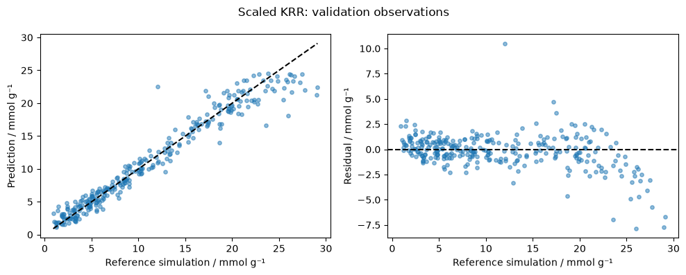
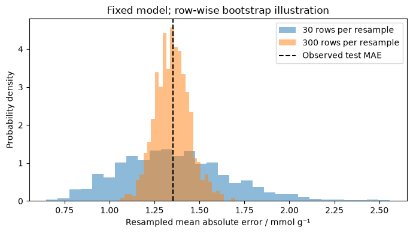

With the calibration curve, one number described the input: concentration. A porous material gives us many more possibilities. Before we can learn anything from a collection of structures, we have to decide how to describe them and what we want to predict.

## A porous material and a prediction

Suppose we have a collection of porous materials and would like to decide which deserve a more expensive calculation. A metal–organic framework, or **MOF**, connects metal-containing nodes with organic linkers. Different choices of nodes and linkers give different pore geometries and chemical environments. How much carbon dioxide might a particular framework take up?

We can ask a more manageable version of that question. Our table contains uptake values computed by molecular simulation, along with descriptions of the structures. We will try to predict the computed uptake of another entry in that collection. The target concerns pure CO₂ at 298 K and 1.6 MPa, or 16 bar, in mmol per gram of framework. These conditions are part of the target, even though they do not vary between rows. The exercise adapts the [MolSim practical](https://github.com/kjappelbaum/ml_molsim/tree/0ebed176b972c9ba9ddf7b6e3a4d04eaf3f32409).

It is tempting to shorten the question to “find a good material for carbon capture.” But that would add questions about mixtures, water, stability, regeneration, synthesis, and the process in which the material will be used. A prediction at one set of conditions can help with that work. It does not specify the whole decision.

### Where does the learned model enter? {#where-ml-enters}

There is more than one place to use learning in this calculation. The diagram in my [MolSim lecture, p. 3](https://www.compchem.nl/wp-content/uploads/molsim2023/L09_Machine-Learning.pdf#page=3), puts those possibilities beside one another.

One route to uptake begins with a model of the interactions between atoms and molecules. A simulation then samples configurations and uses them to estimate the amount adsorbed under the specified conditions. We could learn an approximation to the interaction energies and use it within that simulation. Alternatively, we could collect the uptake values from completed simulations and learn to predict those values directly. This second route is what our practical does. Its predictor is a **surrogate** for a specified simulation result.

There is a further possibility: keep the energy model and learn a way to propose configurations that would otherwise be difficult to sample. We will return to that distinction when discussing molecular simulation. Learning the energy, learning a final property, and helping explore configurations change different parts of the calculation. They therefore require different checks. Agreement with a set of uptake values does not establish that a model can calculate forces or generate a physically meaningful trajectory.

## What do we keep from a structure?

Imagine replacing a framework drawing with two numbers: its density and its pore volume per gram. We have retained information that might be useful for gas uptake, while discarding the identities and arrangement of many atoms. These numbers are [descriptors](../glossary.qmd#descriptor). In the practical, eight geometric descriptors become the model's [features](../glossary.qmd#feature).

| Information we supply | Example | What remains open |
|---|---|---|
| Pore dimensions | A diameter describing a sphere that can pass through the pore network | Which chemical groups line that pore? |
| Surface area and pore volume | Surface area per gram; pore volume per gram | How strongly does CO₂ interact with the surface? |
| Density | Framework mass per volume | Are two frameworks with similar density chemically similar? |

The [data notes](../data/mof-uptake/README.md) give the exact column names, units, and source. The target is a simulation result. A model that reproduces it accurately approximates that calculation; comparison with experimental uptake is a further step.

**Discuss:** Which two frameworks might look similar through these descriptors while differing in a way that matters for adsorption?

### Which changes should matter? {#which-changes-should-matter}

There are also differences we deliberately want a representation to ignore. Take an isolated molecule, with no external field, and rotate all its atomic coordinates together. We have changed the numbers in the coordinate table without changing its internal geometry. Its energy should stay the same. Stretching one bond is a different operation: now an energy change is possible.

This gives us a concrete requirement before we fit anything. We could supply distances between atoms, which stay unchanged under a rigid rotation, or build that requirement into the model. We could also train on rotated copies, although a finite collection of copies does not by itself guarantee the property for every rotation. These are different ways of using chemical knowledge to constrain learning. The [MolSim lecture, pp. 12–13](https://www.compchem.nl/wp-content/uploads/molsim2023/L09_Machine-Learning.pdf#page=12), compares them; the three-approach slide credits Tess Smidt.

The requirement depends on the output. An unchanged energy is **invariance**. A force arrow must rotate with the molecule, which is **equivariance**. For our uptake model, simply rotating the coordinate system should likewise leave the scalar prediction unchanged. Replacing a linker with another chemical group may change uptake, yet our eight geometric descriptors might not preserve enough information to distinguish that change. Ignoring an arbitrary orientation and discarding chemical information have different consequences.

**Discuss:** Which of these operations changes the physical system, and which changes only its description? What would you want an energy predictor to do in each case?

## A prediction without descriptors {#first-ask-whether-the-inputs-help}

Before fitting a relationship, predict the same uptake for every material. Our **baseline** uses the median training uptake. It ignores the descriptors entirely. If a more elaborate model cannot improve on that reference, the extra machinery has not yet earned its place.

We compare models using mean absolute error:

$$
\operatorname{MAE}=\frac{1}{n}\sum_{i=1}^n |\hat y_i-y_i|.
$$

For residuals $-2,0,+1$ mmol/g, the MAE is $1$ mmol/g. The median minimises the sum of absolute deviations for a constant prediction. Choosing squared error would instead lead us to the mean. We have already made a modelling choice before selecting a learning algorithm.

## Why would changing units change a prediction?

One model in the practical compares materials through distances between their feature vectors. Suppose two rows differ by 0.1 g/cm³ in density and by 100 m²/g in specific surface area. If we take the numerical values as coordinates, their squared differences contribute 0.01 and 10,000. Expressing the same surface area in m²/kg multiplies that coordinate difference by 1,000. The materials have not changed, but their numerical distance has. Before using distance as a measure of similarity, we need to decide what a step along each coordinate should mean.

**Standard scaling** subtracts each feature's training mean and divides by its training standard deviation. The resulting coordinates are dimensionless. This makes the distance insensitive to a consistent change of units, but it still gives each feature a particular weight: one training standard deviation. That is a modelling convention, not evidence that the features are equally informative. The transformation is itself fitted, so we estimate those means and standard deviations from training data and apply the same transformation to validation and test data. A [pipeline](../glossary.qmd#preprocessing) keeps the transformation and model together.

## From a straight line to similarities {#kernels-as-functions}

Our calibration line adds two functions, a constant and a multiple of concentration. A polynomial adds further powers. We choose these building blocks first and then fit their coefficients. A kernel model offers another construction: place a function at each training input and fit the coefficients of their sum. This is the comparison in the [MolSim lecture, pp. 53–57](https://www.compchem.nl/wp-content/uploads/molsim2023/L09_Machine-Learning.pdf#page=53).

The original practical uses **[kernel ridge regression](../glossary.qmd#kernel-ridge)**. Our Gaussian kernel gives a similarity to two scaled feature vectors $x$ and $z$:

$$
k(x,z)=\exp\left(-\gamma\lVert x-z\rVert^2\right).
$$

The squared distance $\lVert x-z\rVert^2$ adds the squared differences between corresponding entries. The setting $\gamma$ controls how quickly similarity falls with distance. For a single input coordinate, each training example becomes the centre of a bell-shaped function. A larger $\gamma$ makes that bell narrower. The prediction is

$$
\hat y(x)=\sum_{i=1}^{n_{\mathrm{train}}} a_i\,k(x,x_i).
$$

Here $x_i$ is a training input and $a_i$ is its fitted coefficient. The coefficients can be negative, and the sum is not a normalised average of nearby uptake values. The regularisation setting $\alpha$ controls the penalty used during fitting. We will compare an unscaled and a scaled version with the same settings. A scaled linear ridge model provides another useful comparison. [scikit-learn's KRR introduction](https://scikit-learn.org/stable/modules/kernel_ridge.html)

### Adding three functions

The small demonstration below uses three invented observations and one dimensionless input. The coloured curves show the three weighted contributions; the dark curve is their sum. Moving the query changes where we evaluate the same fitted function. Changing $\gamma$ or $\alpha$ fits a new function to the same observations.

```{=html}
<iframe class="activity" src="../activities/kernel.html" title="Three Gaussian kernel functions and their fitted sum"></iframe>
```

[Open the kernel demonstration](../activities/kernel.html). First move the query and add the three displayed contributions. Then predict what will happen when the bells become narrower, before changing $\gamma$. Can you find a region where the curves disagree although there is no observation to decide between them? These three training observations cannot establish which setting predicts future measurements better.

In the MOF practical, each input has eight coordinates rather than one. The construction is the same, but now the distance depends on every descriptor and its scale.

## Choosing a model with validation data {#which-observations-may-influence-the-choice}

Our compact table contains 1,500 rows selected from the workshop data without selecting on uptake. The notebook assigns 900 rows to training, 300 to validation, and 300 to the final test. We inspect training observations, fit the candidate models, and compare their validation errors. We then freeze the choice and calculate its test error.

A different identifier does not necessarily mean a chemically independent framework. Two MOFs may share building blocks. This random row split supports a limited question about other entries in this collection; testing a new framework family would require a suitable definition of families and a split that respects it.

The data-leakage case study in [Jablonka et al. (2023), *An Ecosystem for Digital Reticular Chemistry*](https://doi.org/10.1021/acscentsci.2c01177), examines why data preparation and evaluation belong together. It gives us a research example against which to question our own split.

The plot below shows the chosen model's **validation** predictions in the supplied run. In the left panel, the diagonal marks agreement with the reference simulations. The right panel makes the residuals visible. These observations helped us choose the model, so they cannot also supply its untouched final assessment.



### Which materials does an average describe? {#average-for-which-materials}

Suppose our purpose is to find unusually high-uptake materials. A random validation sample can contain many ordinary materials and very few exceptional ones. A low average error over the whole sample may then tell us little about the region we hope to search. The [MolSim lecture, p. 25](https://www.compchem.nl/wp-content/uploads/molsim2023/L09_Machine-Learning.pdf#page=25), raises this problem for material screening.

In our validation plot, inspect the high-uptake region separately. How many points support a claim there, and do the errors look similar to those elsewhere? An observation here can suggest a further evaluation, but it does not turn this region into an untouched test set. If selecting the best candidates is the intended use, we should plan an assessment of that selection before making a discovery claim. Predicting uptake accurately on average and selecting useful candidates are related tasks with different evidence requirements.

## The uncertainty in a test error {#a-test-score-still-has-a-hat}

The chosen model gives one error for each of the 300 reserved test rows. Averaging them gives an empirical test MAE. The calculation can be exact for those rows while the expected error on future cases remains uncertain.

Keep the fitted model fixed and draw samples, with replacement, from the recorded test errors. This [bootstrap](../glossary.qmd#bootstrap) creates a distribution of average errors under a particular sampling assumption. The notebook compares averages of 30 sampled rows with averages of 300. The larger averages fluctuate less in this illustration.



The calculation treats rows as independent sampling units. It adds no new frameworks, simulations, or experiments. Related frameworks can make that assumption inadequate, and repeating rows from this collection does not tell us how a model will perform under another simulation protocol. This is the distinction between [sampling uncertainty and a change in distribution](02-learning-from-data.qmd#empirical-error-and-population-risk) in a chemical setting.

## Practical

Download and extract the complete [MOF practical kit](../downloads/mof-practical.zip). It contains the [notebook](../notebooks/03-mof-uptake.ipynb), data, source notice, and locked environment. From its folder, use Ubuntu on WSL for Windows, or your macOS/Linux terminal:

```bash
uv sync --locked --group mof
uv run --locked --group mof jupyter lab --no-browser
```

Open `notebooks/03-mof-uptake.ipynb`. The saved outputs and figures above also let you discuss the results if your environment is not ready. They include the test results of the supplied run, whose model was selected using validation data. Once you have viewed those results, changes to your own model are exploratory; those same rows cannot provide a fresh, untouched assessment of the revised procedure.

1. Read one training row. State the target, its conditions, and one omission in the representation.
2. Predict whether scaling will help KRR. Run the comparison and explain what changed.
3. Change one setting or feature and use validation results to choose what to retain. Record the choice and whether you have already inspected the saved test results.
4. Trace the supplied run from its validation-based choice to its reserved test evaluation. State the metric, units, number of test rows, split procedure, and intended scope. If you make a new choice after seeing the test results, report it as exploration.
5. Keep the model fixed during resampling. Explain what the spread shows and what uncertainty it leaves out.

If you change the model after reading test results, the exercise becomes further exploration. A new final assessment would need fresh evaluation data.

### Which descriptors does the model use? {#an-optional-question-about-the-model}

The notebook can shuffle one descriptor among validation rows and measure how much the fitted model's error changes. This **[permutation importance](../glossary.qmd#permutation-importance)** concerns the model's reliance on information disrupted by the shuffle. A shuffle can break relationships between density, surface area, and pore volume; it need not describe physically possible materials. How would that differ from changing a linker and measuring adsorption? [scikit-learn's interpretation guide](https://scikit-learn.org/stable/modules/permutation_importance.html)

### Checking the assistant's code {#using-an-llm}

Ask for a small MAE function. Predict its output for residuals $-2,0,+1$, then run that check and an exact-prediction case. Explain which operation prevents positive and negative errors from cancelling. The notebook includes the checks, so this exercise also works without chatbot access.

## What can we conclude? {#exit-question}

Complete three sentences: which model you chose and why; what its empirical test score estimates; and what further evidence you would need before using it for an experimental adsorption decision.

## Suggested reading

Hardt and Recht's [**Sample versus population**](https://mlstory.org/supervised.html#sample-versus-population) remains relevant here: our test rows are a sample, and we have to decide which future cases they can represent.

Moosavi et al. (2020), [*Understanding the diversity of the metal-organic framework ecosystem*](https://doi.org/10.1038/s41467-020-17755-8), examines what makes a new structure informative. The [PubMed record](https://pubmed.ncbi.nlm.nih.gov/32792486/) provides the abstract and links open full text. **Case Study 1: The impact of data leakage**, in the Appendix of Jablonka, Rosen, Krishnapriyan, and Smit (2023), [*An Ecosystem for Digital Reticular Chemistry*](https://doi.org/10.1021/acscentsci.2c01177), connects related structures to evaluation. An [open copy and further references on chemical data](../reading.qmd#molsim) are linked in the suggested reading.

The [original MolSim 2024 notebook](https://github.com/kjappelbaum/ml_molsim/blob/0ebed176b972c9ba9ddf7b6e3a4d04eaf3f32409/molsim_ml.ipynb) contains further exercises on descriptors, hyperparameter searches, and model inspection. The [data notes](../data/mof-uptake/README.md) explain how its data were adapted for this practical.
